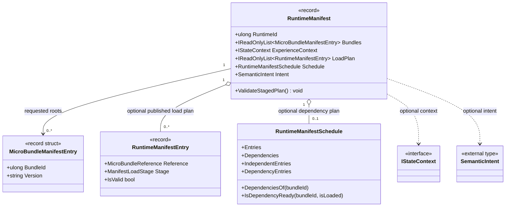

# `RuntimeManifest` — UML relationships and use cases

**Focus type:** [`RuntimeManifest`](RuntimeManifest.md)  
**Source:** [`RuntimeManifest.cs`](RuntimeManifest.cs)  
**Authority:** [Runtime Manifest contract](../../docs/RUNTIME_MANIFEST.md)

> This diagram is a source-grounded interim model written in Mermaid. It is not yet emitted by the GUI source-derived UML generator. Relationship directions below represent data ownership/reference, not execution or loading order.

## Class relationships

**Interpretation:** the root bundle list requests versions; the optional published plan adds artifact identity and stage; the schedule describes dependency relationships. The schedule is not an FSM_API process scheduler. Repository/localization adapters own artifact retrieval and hash verification.

## Use cases

These are maintainer-facing scenarios grounded in the current public contract and documentation, not scenarios inferred automatically from reflection. Treat the actor and success path as a proposed use-case model to review with the package maintainer.

### UC-RM-01 — Request a runtime composition

- **Actor:** host application or composition caller.
- **Goal:** request an assembly containing specified root MicroBundles at explicit versions.
- **Trigger:** the host is ready to call `FsmCos.Execute` with a manifest.
- **Preconditions:** each root entry has a non-zero bundle ID and a non-empty requested version; the host can provide the required composition dependencies.
- **Success path:** construct `RuntimeManifest`; FSM_COS validates and resolves the requested roots and dependency closure; on successful composition the host receives a `RuntimeAssembly`.
- **Alternatives/failures:** missing or incompatible dependencies, invalid request data, or arbitration failure prevents successful composition.
- **Evidence/status:** current contract; cross-check [Execute Sequence](../../docs/EXECUTION_SEQUENCE.md) and [Runtime Manifest](../../docs/RUNTIME_MANIFEST.md). Maintainer review of actor wording remains open.

### UC-RM-02 — Validate published staged metadata before use

- **Actor:** host or publication/integration tooling.
- **Goal:** detect disagreement between root requests and optional published load-plan/schedule metadata.
- **Trigger:** caller invokes `ValidateStagedPlan()`, or the composition path validates the manifest.
- **Preconditions:** a manifest exists; if staged metadata is supplied, its entries should describe the same requested roots and consistent identities/stages.
- **Success path:** bounded snapshots are checked; each requested root must exist in the plan at the requested version; if both plan and schedule exist, their identities and stages must agree.
- **Alternatives/failures:** invalid or duplicate plan entries, a missing root, version mismatch, or schedule/load-plan disagreement throws `InvalidOperationException`.
- **Evidence/status:** source-grounded behavior in [`RuntimeManifest.cs`](RuntimeManifest.cs) and [`RuntimeManifestPlanningTests.cs`](../../tests/FSM_COS.Tests/RuntimeManifestPlanningTests.cs). This validates metadata only, not artifact availability or hash correctness.

### UC-RM-03 — Represent an intentionally empty composition request

- **Actor:** host or test fixture.
- **Goal:** create a manifest with no requested root bundles while retaining optional context and intent.
- **Trigger:** caller uses `RuntimeManifest.Empty(runtimeId, experienceContext, intent)`.
- **Success path:** receive a manifest whose root bundle list is empty and whose optional values are preserved.
- **Alternatives/failures:** later composition behavior depends on the caller's execution path and is not promised by the factory itself.
- **Evidence/status:** factory implementation in [`RuntimeManifest.cs`](RuntimeManifest.cs); confirm expected empty-runtime semantics with maintainers before promoting this scenario as a product-level guarantee.

## Model provenance and review

- **Structural facts:** extracted from the current `RuntimeManifest.cs` declarations and the related source types.
- **Behavioral claims:** tied to the source and linked tests/docs above.
- **Human-authored intent:** the use cases are explicit draft scenarios, not generated claims. Their wording and status need maintainer review.
- **Generator boundary:** GUI should eventually generate the class card/relationships from a stable semantic model, while use-case intent remains explicitly authored or reviewed.
